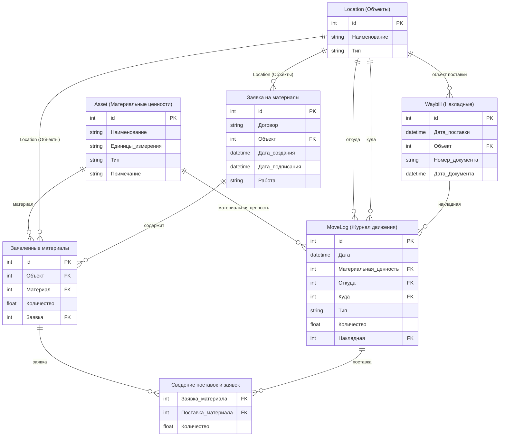

---
tags:
  - data_base
  - stage_1
status: active
created: 26-10-2026
---
# База данных

## Описание базы данных
### Система учета  
#### Asset - Таблица «Материальные ценности»
(справочная):  
	- id (тип INT, PRIMARY KEY, AUTOINCREMENT, NOT NULL);  
	- Наименование (тип STR, NOT NULL, UNIQUE);  
	- Единицы измерения (тип STR, NOT NULL);  
	- Тип (тип STR, NOT NULL) — поле будет указывает на то относится ли данная запись к материалу или оборудованию; 
	- Примечание (тип STR, NULL) — столбец для текстовой заметке;  
#### Location - Таблица «Объекты»
(справочная):  
	- id (тип INT, PRIMARY KEY, AUTOINCREMENT, NOT NULL);  
	- Наименование (тип STR, NOT NULL, UNIQUE);
	- Тип (тип STR, NOT NULL) — столбец для обозначения является ли объект строительной площадкой или же складом;  
#### MoveLog - Таблица «Движения»
(для учета) — в таблице отображаются все движения материальных ценностей:
	- id (тип INT, PRIMARY KEY, AUTOINCREMENT, NOT NULL);  
	- Дата (тип DATETIME, NOT NULL);  
	- Материальная ценность (тип INT, FOREIGN KEY, REFERENCES Материальные ценности(id), NOT NULL) — столбец для ссылки на материальную ценность;  
	- Откуда (тип INT, FOREIGN KEY, REFERENCES объекты(id), NULL) — столбец ссылающийся на объект откуда было перемещение, это поле может быть пустое для записи, если это поставка, а не перемещения между объектами;  
	- Куда (тип INT, FOREIGN KEY, REFERENCES объекты(id), NOT NULL) — столбец ссылающийся на объект куда было выполнено перемещение, это поле не может быть пустым;  
	- Тип (тип STR, NOT NULL) — столбец указывает является запись «перемещением» или «поставкой»;  
	- Количество (тип Float, NOT NULL) — количество перемещаемых материальных ценностей;
	- Накладная (тип INT, FOREIGN KEY, REFERENCES Накладные(id), NULL) — столбец ссылается на запись в таблице «накладная», остается пустой для перемещений или если нет официальной накладной;
#### Waybill - Таблица «Накладные»
таблица для данных о накладной:  
	- id (тип INT, PRIMARY KEY, AUTOINCREMENT, NOT NULL);  
	- Дата поставки (тип DATETIME, NOT NULL);  
	- Объект (тип INT, FOREIGN KEY, REFERENCES Объекты(id), NOT NULL);  
	- Номер документа (тип STR, NULL);  
	- Дата Документа (тип DATETIME, NULL);  
#### **Таблица «Заявленные материалы»**
Таблица с записями о заявленных (требуемых) материалах:  
	- id (тип INT, PRIMARY KEY, AUTOINCREMENT, NOT NULL);
	- Объект (тип INT, FOREIGN KEY, REFERENCES Объекты(id), NOT NULL);  
	- материал (тип INT, FOREIGN KEY, REFERENCES Материальные ценности(id), NOT NULL);  
	- количество (тип Float, NOT NULL) — количество перемещаемых материальных ценностей;  
	- заявка (тип INT, FOREIGN KEY, REFERENCES Заявки на материалы(id), NULL);
#### **Таблица «Заявка на материалы»**
Таблица для данных о заявках на материалы;  
	- id (тип INT, PRIMARY KEY, AUTOINCREMENT, NOT NULL);  
	- Договор (тип STR, NULL);  
	- Объект (тип INT, FOREIGN KEY, REFERENCES Объекты(id), NOT NULL);  
	- Дата создания (тип DATETIME, NOT NULL) — дата создания заявки;  
	- Дата подписания заявки (тип DATETIME, NOT NULL) — дата подписания заявки;  
	- Работа (конструкция) (тип STR, NOT NULL) — название работы и конструкции на которую делается заявка
#### **Таблица «Сведение поставок и заявок»**
Таблица для организации связи многие ко многим, отображающая закрытие заявок на материалы по каждой позиции:  
	- Заявка материала (тип INT, FOREIGN KEY, REFERENCES Заявленные материалы(id), NOT NULL) - ссылка на заявленный материал;  
	- Поставка материала (тип INT, FOREIGN KEY, REFERENCES движения(id), NOT NULL) — ссылка на поставку в таблице движения;  
	- количество (тип Float, NOT NULL) — Количество поставленного материала относящегося к заявке (Нужна в том случае если одна поставка одной позиции относится к разным заявкам).